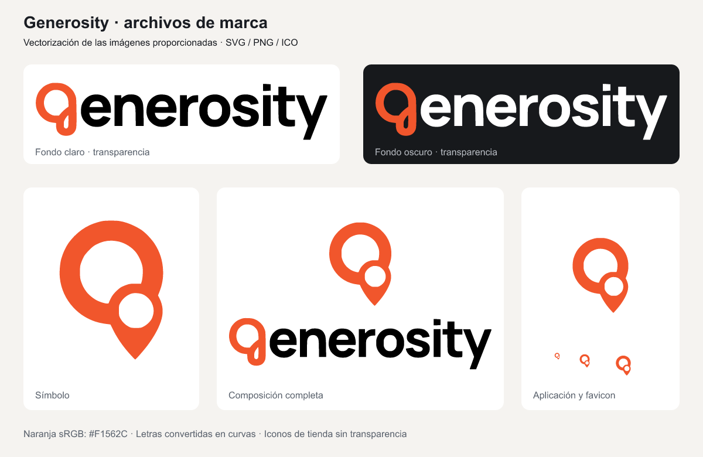

# Generosity — brand assets

Generated from the user's `gen2.png` and `Untitled.png`, supplied on
2026-10-31. The originals are retained unchanged in this repository's `source/`
directory. `gen2.png` provides real transparency; `Untitled.png` is the visual
reference with an opaque light background. No replacement font is used.



## Files and use

| Location | Contents / use |
| --- | --- |
| `svg/symbol.svg` | Orange symbol with transparent counters/background. |
| `svg/wordmark.svg` | Original orange “g” and black outlined letters; light surfaces. |
| `svg/wordmark-dark.svg` | Orange “g” and white outlined letters; dark surfaces. |
| `svg/stacked.svg`, `stacked-dark.svg` | Symbol above the name, following the supplied composition. |
| `svg/symbol-black.svg`, `symbol-white.svg` | Single-color symbol variants. |
| `svg/app-icon.svg` | Square opaque white icon, ready for platform masking. |
| `png/` | Rendered counterparts: 2048px-wide wordmarks/compositions; 1024px-wide symbols and square app icon. |
| `web/favicon.ico` | One ICO containing 16, 24, 32, 48, 64, 128 and 256px images. |
| `web/` | SVG favicon; 16/32px PNG favicons; 180px Apple touch icon; 192/512px web-app icons; separate 512px maskable icon and manifest template. |
| `verification.json` | Measured tracing fidelity and export checks. |
| `generosity-brand-kit.zip` | Export package, including native resource folders; excludes the original screenshots and their metadata. |

The SVG masters contain actual curves, including the lettering. They do not
embed a bitmap or depend on font installation. These are reconstructed vectors
from the provided raster images, not recovered original designer source files.
Tracing smooths the pixel edges; silhouette intersection-over-union is 99.07%
for the symbol and 98.97% for the wordmark at source resolution.

The source PNGs are tagged **Display P3**. Conversion to **sRGB** gives the
brand orange **`#F1562C`**. Copying the raw PNG channel values would change its
appearance. App controls retain their darker accessible action orange; the
brand mark itself uses the measured source color. Dark variants change only
the lettering to white. Logos retain transparency; store/launcher icons use a
solid white background and have no prerendered rounded corners.

## Native integration

- Android uses the generated `generosity_wordmark.xml` in its header, with
  light/dark text colors. The launcher uses `@mipmap/ic_launcher`: an adaptive
  foreground/background on API 26+, a monochrome layer on API 33+, and PNG
  density exports. The foreground fits within the central 66dp safe circle.
- iOS uses `GenerosityWordmark.imageset` with light/dark SVGs and preserved
  vector representation. `GenerositySymbol.imageset` is available for welcome
  work. `AppIcon.appiconset` supplies iPhone/iPad sizes plus an opaque RGB
  1024px marketing icon; the Xcode target selects `AppIcon`.
- The web folder is a ready-to-copy kit for the portal's separate workstream.
  Its template is not linked into the portal yet. Copy its files to the public
  deployment root, or adjust icon URLs and `start_url` for the final route.
  Adding a manifest alone does not implement offline/PWA functionality.

Example when the `web/` files are served at the site root:

```html
<link rel="icon" href="/favicon.ico" sizes="any">
<link rel="icon" href="/favicon.svg" type="image/svg+xml">
<link rel="apple-touch-icon" href="/apple-touch-icon.png">
<link rel="manifest" href="/manifest.webmanifest">
```

## Regenerate and verify

From the repository root:

```bash
brew install potrace
python3 -m venv /tmp/generosity-brand-venv
/tmp/generosity-brand-venv/bin/pip install -r scripts/brand-requirements.txt
/tmp/generosity-brand-venv/bin/python scripts/generate-brand-assets.py
xcodegen generate --spec iosApp/project.yml
```

Generation uses [Potrace 1.16](https://potrace.sourceforge.net/) for smooth
outlines and [resvg](https://resvg-py.readthedocs.io/en/latest/api.html) for PNG
rendering. These are asset-authoring tools, not mobile runtime dependencies.
The script checks SVGs for embedded images/font text, compares traced masks
with the source, checks ICO sizes, iOS alpha removal and the Android safe zone.
It also rebuilds the ZIP. Native compilation/runtime checks are recorded in
the repository's [visual verification](../../docs/testing/native-visual-verification.md).

In the exported ZIP, Android resources are under `android/res/` and iOS assets
under `ios/Assets.xcassets/`. Source PNGs, generation code and build logs remain
in the repository. Keep aspect ratio when using the logos; do not stretch them
to fit a control.
