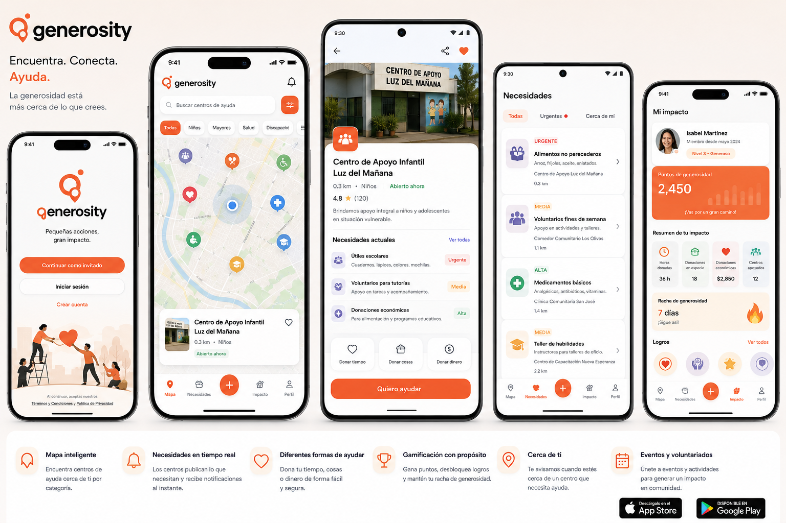

# Generosity Visual Reference

Received from the user on 2026-10-25 as
`codex-clipboard-4e91ebb0-9a4e-4e5b-83fd-c020b4714e9e.png`.
The original image is retained below so the reference survives the temporary
attachment directory.

## Status and Authority

On 2026-10-31 the user supplied `gen2.png` and `Untitled.png` and requested SVG,
ICO and other required assets. The [brand kit](../assets/brand/README.md) retains
both originals and provides traced outlines, transparent exports, light/dark
wordmarks and native/web icons. These assets replace the earlier approximate
header mark; the product concept below remains the layout reference.

This is a visual/product concept, not a screenshot of the current apps.
On 2026-10-25 the user explicitly requested the welcome layout and its three
entry actions; see [mobile-welcome](../openspec/changes/define-generosity-mobile-app-foundation/specs/mobile-welcome/spec.md).
The user subsequently requested closer visual alignment for the other screens
and explicitly chose design only, keeping new functions separate. See
[mobile-visual-alignment](../openspec/changes/define-generosity-mobile-app-foundation/specs/mobile-visual-alignment/spec.md).
That styling phase preserves Map/List/Profile/Settings. The subsequent request
now scopes the missing functions separately in
[add-reference-product-features](../openspec/changes/add-reference-product-features/spec-index.md):
new navigation/feed, favorites, sharing, photos/hours, moderated reviews,
gamification, inbox, events and gated external-provider payments. This is a
later functional phase, not a silent expansion of the styling task.
Sample centers, people,
ratings, distances, balances and statistics are illustrative, not verified
catalog data. Store badges do not mean the app has been published.

The normative contracts remain in `openspec/specs/`. Existing implementation
gaps are tracked in the [reopened foundation](../openspec/changes/define-generosity-mobile-app-foundation/tasks.md).
The active [spec index](../openspec/changes/define-generosity-mobile-app-foundation/spec-index.md)
now includes the requested welcome and all identified mobile gaps plus the
explicitly added backend and center web portal. These are planning artifacts,
not implemented UI. There are now 16 foundation and 10 follow-up capability
specs. The existing landing has a separate [source assessment](center-portal.md);
its publishing workspace must work mobile-first without adding staff controls
to the consumer app's plus action.

## Visual Direction

- Lowercase generosity wordmark with a coral/orange location/heart-like mark.
- White surfaces, dark text, orange primary actions and category-specific accents.
- Map-led discovery with compact search, category filters, category markers,
  current position and a selected-center preview.
- Photo-led center details with clear help methods and urgency labels.
- Native-feeling bottom navigation and compact needs/impact summaries.

Exact colors, typography, assets, licensing and component measurements are
not defined by this raster reference. The 2026-10-31 native visual pass records
the implemented [tokens, spacing and supplied-logo provenance](native-visual-style.md).
Spanish copy must also have English
resources. Visual acceptance includes contrast, non-color urgency cues, text
scaling and small-screen verification; it is not an exact cross-platform pixel copy.

## Screen and Capability Mapping

| Concept | Existing contract / implementation | Decision or work still needed |
| --- | --- | --- |
| Welcome, guest, sign-in, create account | Welcome and real identity are now specified in the active change; current apps still have demo entry behavior. | Implement the specified layout/routes, select a provider and supply approved assets/legal destinations. Guest discovery remains available. |
| Map with search and category markers | `kindness-center-discovery` plus the new visual spec; Android now has a replaceable Google Maps adapter, while iOS retains MapKit with a fixed initial region. | Live Google acceptance still needs a key and Google-enabled device; see [native maps](native-maps.md). Map-led styling, current location and distance remain separate functional/visual tasks. |
| Map / Needs / plus action / Impact / Profile navigation | Current apps use Map / List / Profile / Settings. | Styling preserves these initially. The follow-up specifies the new shell, plus choice, account summary and migration of list/settings/history; center publishing stays in the web portal. |
| Center photo, sharing, favorite, open status, rating | Existing detail contract covers location, categories, description, contacts, verification and needs. | Follow-up specs now cover safe representative media, timezone-based hours, public links, favorites and completed-help reviews with moderation. None is implemented yet. |
| Needs feed with All / Urgent / Nearby filters and View all | The foundation specifies needs within center details. | `global-needs-feed` now specifies public cross-center browsing, explicit center constraints, filter/radius/pagination rules and no-location fallback. |
| Donate time / goods / money and I want to help | Shared offers and payment boundary exist; Android sends fixed values, iOS only displays needs. | Foundation forms/history remain prerequisites. Follow-up contextual helping retains center/method; external donations add hosted checkout and verified financial outcomes subject to provider/release gates. |
| Personal impact: hours, goods, currency, centers | Shared aggregation counts only confirmed/fulfilled entries; UI is incomplete. | Style account identity, labeled metrics and history inside Profile. The unit/provenance contract is already specified but not implemented: never turn `hoursOffered` entry counts into hours or monetary counts into a balance. |
| Points, level, streak and achievements | No scoring engine exists. | `impact-gamification` now specifies completed-center-help eligibility, rule versions, daily streaks, badges and a real points chart. Numeric defaults are proposals, not approved balances. No rankings or redeemable rewards. |
| Bell, real-time needs and proximity alerts | Opt-in/permission rules exist, but no delivery pipeline. | Foundation delivery remains open; `notification-inbox` adds owned/readable history and safe destinations without requiring push permission to read notices. |
| Events and volunteering | Time offers exist; no events implementation. | `volunteer-events` now specifies center publication, capacity, enrollment, cancellation and validated attendance linked once to impact. |

## Implementation Boundaries

1. Preserve existing navigation during styling; migrate to the separately specified functional routes only when destinations work.
2. Supply approved brand/media assets. The visual pass uses fallbacks; the follow-up adds actual center media/hours management with provenance and access controls.
3. Implement the now-specified duration/unit/provenance model and approved
   center confirmation authority before displaying real impact totals.
4. Implement the approved completed-help eligibility and record accepted configurable scoring defaults; keep the non-monetary restriction.
5. Staff the moderation workflow and satisfy provider/recipient/release gates before enabling payments. Official verification and tax receipts remain separate; spec creation authorizes no live charges.

Visual tasks are tracked in section 17 of the active checklist. Compare
platform screenshots using the [visual acceptance matrix](testing/mobile-ui-checks.md).
The original planning update changed no UI; the subsequent native visual pass
restyles existing discovery, details/needs, Profile and Settings. Executed
checks and remaining acceptance work are recorded in
[native visual verification](testing/native-visual-verification.md).
The follow-up [coverage index](../openspec/changes/add-reference-product-features/spec-index.md)
maps each new visible feature to its own contract and implementation tasks.
