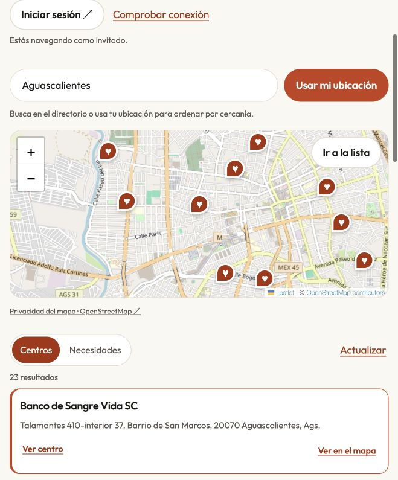

# Public portal release — 2026-11-05

The owner requested publication of the reviewed local portal to `generosity.global`.
Release tag `portal-release-2026-11-05.2` points to `0519898f43f59bfca3099a84bfe7a3a45db78620`
on `codex/backend-php-mysql`. [The final workflow succeeded](https://github.com/devmalvarado/generosity-mobile/actions/runs/42147346371).
The mobile/backend branch was not merged into `main` as part of this release.

## Published scope

- `/`: presentation, three-phone helping illustration and links to dedicated tasks.
- `/ayudar/`: public catalog, real Leaflet/OpenStreetMap basemap, optional browser
  location, directory search, markers and center/need details.
- `/registrar-sede/`: location application and its account entry.
- `/kindness-center/`: dedicated authorized-center workspace and account entry.
- `/app/`: isolated product tour, with 34 screens and ES/EN; its interactions do
  not represent live service-backed capabilities.
- Four former legal-page paths redirect to the canonical API documents.

Exactly 31 files from `portal/public-files.txt` were uploaded. The workflow read
all 31 back through FTPS and compared their bytes against the tagged revision.
Hostinger CDN minifies text and transforms some PNGs, so public HTTP hashes alone
are not the origin-integrity check. The favicon remains the previously published
brand asset. No database migrations, catalog import or account writes ran.

## Required API support repair

The ES/EN privacy notices now describe OpenStreetMap and the location behavior of
this web flow. Their prior versions were verified and backed up under
`private/.deployments/portal-privacy-42145749146-1/` on the API domain.
Registration's existing policy acceptance identifier was retained; the notices
date the provider-information update separately.

Live browser acceptance exposed an outdated CORS configuration: the session
preflight did not allow `X-Generosity-Channel`. The release installed the existing
repository `config/cors.php` and rebuilt only the configuration cache using the
configured PHP 8.4 CLI. A protected temporary helper removed itself after running;
the workflow also attempted cleanup. Source/cache backups are in
`private/.deployments/portal-cors-42147346371-1/`.
No auth controller, provider credential, environment file or application data
was replaced. This does not publish the rest of the pending backend branch.

## Verification

- Existing full browser regression: 135 passed, one intentional duplicate
  screenshot skipped. Publication inventory/route checks rerun: 12 passed.
- Backend suite: 119 tests, 6,077 assertions. Added trusted/untrusted preflight
  assertions in the existing auth test: one targeted test, 19 assertions passed.
- Four release-helper tests passed, including interrupted notice upload,
  uncertain CORS refresh cleanup and an already-supported preflight.
- Both affected OpenSpec changes validate strictly; generated resources match.
- HTTPS routes return 200, `/ayudar` redirects to `/ayudar/`, and the old `#acceso`
  link lands on `/kindness-center/#acceso`. Published HTML has no localhost relay
  metadata. Both hosted privacy languages include OpenStreetMap.
- Public catalog returns 171 centers. In the browser, Aguascalientes returns
  23 results; cartographic tiles load, card selection opens the matching marker,
  and the reviewed viewport has no horizontal overflow.
- Hosted login opens with account creation, Google and the disabled unconfigured
  Apple option. After CORS repair, `/ayudar/` and the center entry display the
  guest session correctly. No new account was created or consent accepted.
- Trusted preflight returns 204 with the channel header; its allowed origin is
  exactly `https://generosity.global`, not a wildcard. A request using an unrelated
  origin does not receive an origin matching that caller. Private applications
  still return 401 to a guest; API health returns 200.

## Open acceptance and limits

The published API still returns 404 for `/api/v1/features`. The portal therefore
keeps feature-dependent writes disabled, including new contribution offers and
publishing needs. Completing the feature-flag API deployment and its authorized
write acceptance is a separate outstanding prerequisite; this release does not
claim those transactions are usable. No fallback silently enables them.

An authenticated account round trip, physical Safari/Chrome GPS permission,
virtual keyboard and screen-reader acceptance were not repeated in this release.
The map's physical location tests remain open. Public OSM tiles provide no SLA;
the directory remains available when cartography fails.

New local web/API work appeared during publication and was not included in the
tagged revision. It remains in the working tree for its own validation/release.
Future `main` releases must include these route changes before publishing older
portal sources again; the explicit release tags do not merge the branch.
